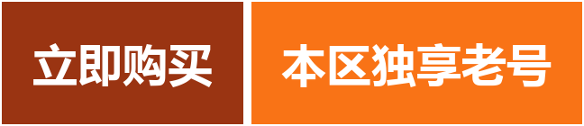

# 土耳其区 Apple ID 怎么获取｜土耳其语界面与外区应用下载指南

[土耳其区 Apple ID 获取与使用指南：土区是全球知名的低价区，应用与订阅价格明显低于美区，常被用来订阅流媒体与购买付费应用。本仓库说明土区账号的真实成本、风控严格程度、以及哪些场景适合用土区、哪些不适合。](https://nbid666.com/categories/TR)

<b>👇 三个都是按钮，点哪个进哪个</b>

  
    
  
    
  

> 最近更新：2026-11-11

<!-- AUTO-STATUS:BEGIN -->
> **今日状态 · 2026-11-11**｜可用 **8 个账号**（美区 5 · 台湾区 1 · 日本区 1 · 韩国区 1）｜近 24 小时轮换 57 次，近 7 日 270 次
>
> **土耳其区独享老号现货**｜支持转区 · 自动发货 · 账号池每 6 小时复核
<!-- AUTO-STATUS:END -->

## 为什么有人专门要土耳其区账号

土区的唯一优势就是**便宜**。同样的订阅服务，土区价格常常只有美区的三分之一到一半。很多人的第一张外区账号就是土区。

这个区能下载到的典型内容：**低价订阅（流媒体、音乐）、付费应用、小火箭**。

典型用户：只想低价订阅流媒体或音乐服务、愿意为省钱接受一定折腾成本的人；以及批量采购付费应用自用的小型团队。

---

## ⚠️ 使用铁律（所有外区账号通用）

**① 只登 App Store，不登 iCloud**
App Store → 右上角头像 → 拉到底 → 退出登录 → 输入账号。
**不要**在「设置」最顶部登录，那是 iCloud 入口，会带来激活锁风险。

**② 弹「升级账户安全」选「不升级」**
选「其他选项」→「不升级」。开了双重认证，其他人就用不了了。

**③ 下载完立刻退出**
不退出会占用账号、触发风控、被锁号——这是共享账号最常见的死法。

---

## 六步完成下载

1. 打开 **App Store** → 点右上角**头像**
2. 滑到最底部 →「**退出登录**」
3. 输入土耳其区 **Apple ID 与密码** → 登录
4. 弹「Apple ID 安全」→「**其他选项**」→「**不升级**」
5. 商店切到土耳其区 → 搜索目标应用 → 云端图标＝已购 → 下载
6. 下载完**立刻退出**，登录回自己的 ID

---

## 土耳其区特有的注意点

⚠️ 土区是**风控最严**的区域之一：频繁换设备、频繁切换地区、绑定非本地支付方式都容易触发验证。如果只是要下个小火箭，别用土区，用美区更省心。土区适合「订阅省钱」这个单一目的。

---

## 共享号 vs 独享号

| | 共享 | 独享 |
|---|---|---|
| 能否改密码 | ❌ | ✅ |
| 应用更新 | 账号被锁后无法更新 | 随时可更新 |
| 能否内购订阅 | ❌ 会封号 | ✅ |
| 成本 | 免费 | 十几到几十元 |
| 适合 | 临时下一个应用 | 长期使用、订阅、需要更新 |

临时用 → 共享号够了。要长期用或要订阅 → 直接上独享号，别反复折腾。

---

## 获取渠道

| 渠道 | 地址 | 说明 |
|---|---|---|
| **土耳其区独享老号** | [土耳其区现货](https://nbid666.com/categories/TR) | 带密保、可转区、自动发货 |
| **各区老号总览** | [全部商品](https://nbid666.com/products) | 美/港/台/日/韩/土/加/菲同店可选 |
| **免费共享取号** | [实时取号页](https://id.tangping.icu/) | 密码按需获取，失效自动重置 |

本仓库不提供具体账号密码——密码定期轮换，写了也会失效。

---

## 常见问题

**Q：土耳其区账号能下载小火箭吗？**
可以。小火箭在绝大多数非中国大陆区商店都能搜到，土耳其区属于可用区域。

**Q：提示「密码错误」怎么办？**
密码已被系统轮换，回取号页重新获取。

**Q：提示「此 Apple ID 已被锁定」？**
并发登录过多导致，使用者侧无法自救，换一个账号即可。

**Q：下载的应用会消失吗？**
不会。应用装在本机，退出账号不影响使用；但更新时需要重新登录该账号。

---

## 相关资源

- [各区 Apple ID 怎么选（八大区域用途对比）](https://nbid666.com/blog/apple-id-region-guide)

---

## 更新记录

- 2026-11-10：仓库建立，聚焦土耳其区的场景、语言、价格与风控特点
